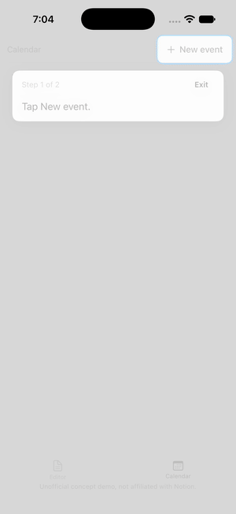
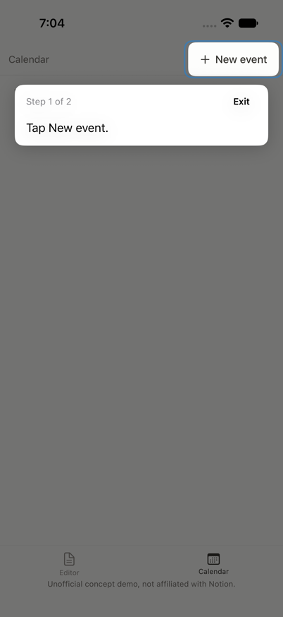
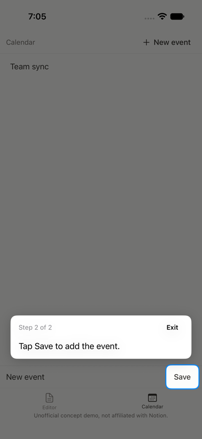
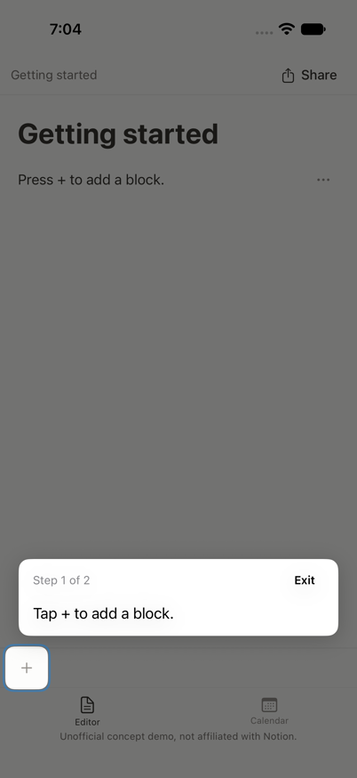
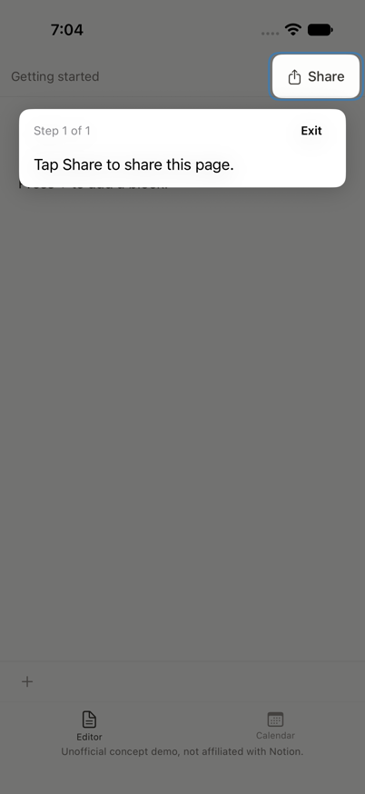

# GuideKit



*Unofficial concept demo, not affiliated with Notion.*

GuideKit is a Swift library for in-app walkthroughs that are checked against the real UI. A team tags controls through its shared components and adds a JSON file. Every walkthrough then doubles as a UI test.

The library is the point. The demo app only exists to exercise it. No LLM is used. Flows are plain data, which leaves that door open later.

## The problem

I run a student club where new people learn Notion. Many find it hard to learn. Asking an AI to do things for them gets the task done but teaches nothing.

An in-app walkthrough teaches: it points at the real control and waits for the person to tap it. The usual problem is that walkthroughs rot. A button gets renamed, the tour points at nothing, and nobody notices until a user does.

GuideKit makes that rot a test failure.

**Assumption:** a multi-team org would use this. Each team owns its own screens and its own flows, so the format has to work without a central owner. I do not know how Notion is organized internally, and nothing here claims to.

## Add a tutorial to your feature

A team does four small things.

1. Tag the control. The shared button already takes an optional ID:

```swift
AppButton("Save", guideID: "calendar.save") { ... }
```

2. Report any state a step needs to check:

```swift
.guideFact("calendar.event.count", value: store.events.count)
```

3. Add `Resources/flows/create_event.json` to the feature package:

```json
{
  "id": "calendar.create_event",
  "title": "Create an event",
  "steps": [
    { "target": "calendar.new_event", "say": "Tap New event.", "completeWhen": { "targetVisible": "calendar.save" } },
    { "target": "calendar.save", "say": "Tap Save to add the event.", "completeWhen": { "fact": "calendar.event.count", "increasedBy": 1 } }
  ]
}
```

Then declare the folder on the feature's target in `Package.swift`:

```swift
resources: [.copy("Resources/flows")]
```

It must be `.copy`. With `.process`, SwiftPM flattens the folder, GuideKit can't find `flows`, and the feature reports a load error.

4. Wrap registration in the feature package. The `prepare` closure shows the right screen before a flow starts:

```swift
public enum CalendarGuide {
    @MainActor
    public static func feature(prepare: @escaping @MainActor () -> Void) -> GuideFeature {
        GuideFeature(namespace: "calendar", bundle: .module, prepare: prepare)
    }
}
```

The app creates one controller from every team's feature, and one host at the root (`Demo/GuideDemo/App/GuideDemoApp.swift`):

```swift
_controller = State(initialValue: GuideController(features: [
    EditorGuide.feature(prepare: {
        shell.selectedTab = .editor
        shell.blocks.closeMenus()
    }),
    CalendarGuide.feature(prepare: { shell.selectedTab = .calendar }),
]))
```

```swift
AppShell(shell: shell)
    .guideHost(controller, launcherBottomClearance: 120)
```

That is the whole adoption. The `?` button opens a menu of every registered flow. `launcherBottomClearance` is optional (84 points by default); raise it if the button would cover your bottom controls. A `prepare` closure should also reset any transient UI, such as an open menu, so a walkthrough begins from a known state. See `Demo/Packages/CalendarFeature/` for the real files.

A step has a `target`, a `say` line, an optional `pick` (`first` or `last` when several views share an ID), and a `completeWhen` check. The checks are `targetVisible`, `fact` with `equals` or `increasedBy`, and `tapped`. Flow IDs must start with the feature's namespace, and the validator checks this at load.

| Calendar flow, step 1 | Step 2 |
| --- | --- |
|  |  |

The dim blocks taps outside the highlighted hole. Taps inside the hole reach the real control, so the user does the real action.

## Architecture

```
  Feature package                          App root
  ---------------                          --------
  flows/*.json  --> GuideFeature --+
  AppButton(guideID:)              +-->  GuideController --> GuideRuntime
  .guideFact(key, value:)  ------> |      (@Observable)      (state machine,
                                          ^        |          no UI imports)
  .guideHost(controller)                  |        v
     collects target frames ------------ +   SpotlightOverlay + menu

  GuideKitCore     Flow model, JSON decoding, FlowValidator, GuideRuntime. No UI.
  GuideKit         SwiftUI: guideTarget, guideFact, guideHost, overlay, menu.
  GuideKitTesting  FlowTestDriver for XCUITest.
```

- A flow is data. `GuideRuntime` is a plain state machine, so it is unit-tested without a simulator.
- `guideTarget` records a view's frame with an anchor preference and sets its accessibility identifier. The host collects the frames at the root.
- If a step's target is not rendered within 5 seconds (a fixed constant), the walkthrough fails and says which flow, step and target.
- `FlowTestDriver` reads `allFlowIDs` from the app's status element, launches the app once per flow, and lets the app's own runtime drive it. It taps each step's current target on the real screen and fails the test if a flow does not finish.

```swift
func testEveryRegisteredFlowCompletes() {
    FlowTestDriver(testCase: self).runAll()
}
```

A new flow is covered by this test as soon as its JSON file exists. It needs no new test code.

## Documentation

Every public type and member carries `///` documentation, and a DocC catalog lives at `Sources/GuideKit/GuideKit.docc/` (a landing page and a Getting Started article built from the demo code). To build it in Xcode, open the package and choose Product > Build Documentation.

For how it works and why it is built this way, start at [`docs/tdd/README.md`](docs/tdd/README.md): one technical design doc per feature, with a mental model, a diagram and an end-to-end trace.

## Regression demo

I renamed the guide ID `editor.add_block_button` to `editor.add_block_button_renamed` in one place and ran the UI tests. This is the real output:

```
failed - `editor.add_heading` step 1: target `editor.add_block_button` not found
failed - `editor.add_todo` step 1: target `editor.add_block_button` not found
```

Each failure names the flow, the step and the target. The flows that did not use that target still passed, and the run kept going past the failures. I reverted the rename afterward.

## Verification

Run on iPhone 17 Simulator.

- `swift test` at the repo root: 59 tests, 0 failures (40 in `GuideKitCoreTests`, 19 in `GuideKitTests`).
- `swift test` inside each demo package with tests: 6 in `Demo/Packages/EditorFeature`, 2 in `Demo/Packages/CalendarFeature`, 0 failures. `DesignSystem` has no test target.
- `xcodebuild test`: 8 UI tests, 0 failures. `testEveryRegisteredFlowCompletes` ran all 5 flows (4 in Editor, 1 in Calendar) and saved a screenshot for each step.

```
xcodebuild test -project Demo/GuideDemo.xcodeproj -scheme GuideDemo \
  -destination "platform=iOS Simulator,name=iPhone 17"

(cd Demo/Packages/EditorFeature && swift test)
(cd Demo/Packages/CalendarFeature && swift test)
```

The demo has three packages: `DesignSystem` (shared `AppButton` and `AppMenuRow`, which take the optional `guideID`), `EditorFeature` and `CalendarFeature`. Calendar was added as an independent team package that only depends on `GuideKit` and `DesignSystem`.

| Editor: add a to-do | Editor: find Share |
| --- | --- |
|  |  |

## Tradeoffs

**Tags in shared components, not accessibility lookup.** Targets are found by an explicit ID, set through the shared component. An accessibility lookup would need no tagging, but labels change with copy and localization, and a rename would silently retarget a step. An explicit ID is stable and greppable. The cost is that a team must use the shared component, or tag the view by hand.

**Tags, not server-driven UI.** The screens stay ordinary SwiftUI. Nothing about the UI is described remotely, so teams keep their normal workflow. The cost is that flows ship with the app and cannot be changed without a release.

**No manifest.** There is no central list of targets or flows. Each feature package carries its own `flows/` folder. This avoids a shared file that every team has to edit. The cost is that nothing checks IDs across teams. The only checks are the namespace rule and the UI test that runs every flow.

## Limitations

- Targets inside system sheets and popovers are not supported.
- Off-screen targets are not scrolled into view.
- VoiceOver can reach controls behind the dim.
- `pick: last` is not exercised with several matches in a UI test. The demo has only one match at that point.
- Rotation has not been verified.
- Anchors are unverified through `TabView`, and `NavigationStack` is untested. Check both before adopting this in a real app; the demo uses a plain in-hierarchy tab bar.
- VoiceOver activation may bypass the tap gesture, so `tapped` steps may not complete for VoiceOver users. This is unverified.
- Any remaining web-based surface would need a different resolver, such as a DOM one. That is optional future work.

## Fit with Notion, from public reporting only

Apple's June 2026 piece (<https://developer.apple.com/news/?id=tejokjnx>) and MacRumors (<https://macrumors.com/2026/06/12/notion-is-migrating-to-swiftui>) say Notion is migrating its iOS UI to SwiftUI. The Pragmatic Engineer (<https://newsletter.pragmaticengineer.com/p/notion-going-native-on-ios-and-android>) covers its move from web-based to native. Public reporting describes the editor as the last part of that migration, so I do not know its current state. Any fit between this library and Notion is inferred from public reporting only. I have no knowledge of Notion's internals.

## Requirements

iOS 17, Swift 6 toolchain. Package products: `GuideKitCore`, `GuideKit`, `GuideKitTesting`.

---

*Unofficial concept demo, not affiliated with Notion.*
