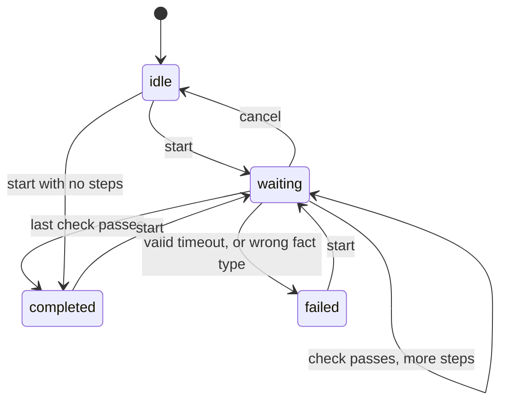

# 03 Runtime

## Purpose

Decide, from a stream of events, when each step is complete or has failed. It is a pure reducer with no UI, clock or threads, so every rule is a unit test.

## Where it lives

`Sources/GuideKitCore/Runtime/`: `GuideRuntime.swift`, `GuideEvent.swift`, `GuideEffect.swift`, `GuideState.swift`, `GuideFailure.swift`.

## How it works

`handle(_ event) -> [GuideEffect]`.

- Events: `start`, `factsChanged`, `targetsChanged`, `targetTapped`, `timeout(token:)`, `cancel`.
- Effects: `present(step:Step)`, `dismiss`, `scheduleTimeout(token:)`.

Entering a step (`enter`): clear `tapped`, invalidate any timer, capture the baseline if the check is `factIncreased` and the fact exists (a non-integer fails with `wrongFactType`), set `armed`, emit `present`, and schedule a timer if the target is absent.

### Arming

`armed` says whether the check may complete the step. If a check is already true when the step appears (a menu already open, a fact already equal to the goal), completing at once would skip a step the person never did. So it starts disarmed. It arms when the person taps the current step's target, or when a target that arrived late is shown for the first time and the check is not already true then. `factIncreased` and `tapped` are never "already true at entry".

### Timer tokens

Timers cannot be recalled once scheduled. Each `scheduleTimeout` carries a new token and `activeToken` records the only one that counts. A `timeout` with any other token is ignored, which covers timers from a step already left, a cancelled run, or a target that came back.

### When timers run

| Situation | Timer |
| --- | --- |
| Step entered and its target is not on screen | Schedule |
| Target present, person has not tapped | None (an idle person never times out) |
| Target disappears before any tap | Schedule |
| Target reappears before the timer fires | Invalidate (`activeToken = nil`) |
| Person taps the current target and the step is not yet complete | Schedule |
| Step changes, run completes, fails or is cancelled | Invalidate |

### What a valid timeout means

- Not tapped, target still absent: `targetNotFound`. Not tapped, target present: nothing.
- Tapped, fact check, fact never reported: `factNeverReported`.
- Tapped otherwise: `checkNotPassed`.
- Mismatched fact type during evaluation: `wrongFactType`.

## Key decisions and why

- **Check `tapped` before target absence on timeout.** A tapped target often navigates away. Checking absence first hid the real failure. Rejected: absence first. Cost: a slightly different failure message.
- **Timer on a target vanishing, invalidated on its return.** Without it a vanished target hangs forever; without invalidation a stale timer fails an idle user. Cost: the five-second grace may be short for slow transitions (one constant to change).
- **Taps are reported for every target** and the runtime ignores all but the current step's. Rejected: attaching the tap gesture only while a `tapped` step is active. The runtime needs taps to arm already-true checks and start post-tap timers. Cost: one extra simultaneous gesture per target.
- **A fact that goes away resets the baseline** for `factIncreased`, so a stale value cannot become a baseline.

## Edge cases and limits

- A second `start` while waiting is ignored. A flow with no steps completes immediately.
- A tap on any target other than the current step's is ignored.
- A failure stays visible in `state` until the next `start`.

## Tests

`Tests/GuideKitCoreTests/Runtime/GuideRuntimeTests.swift` covers the happy path, each check, baselines, arming, every timer row above, stale tokens, wrong fact types and failure text.
