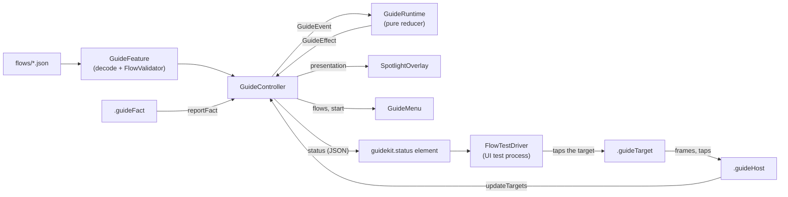

# GuideKit technical design

These documents explain how GuideKit works and why it is built this way. Each feature has one file. Code comments marked `Design:` point here.

## Mental model

A walkthrough is **data checked against the live UI**. A team tags views and writes a JSON flow. At runtime a pure state machine (`GuideRuntime`) is told what is on screen and what the app reports, and decides when each step is done. The same machine runs for a person following the spotlight and for a UI test tapping through, so a stale flow fails a test instead of confusing a user.

## How the pieces connect

Modules: `GuideKitCore` (model, validator, runtime; no UI), `GuideKit` (SwiftUI layer), `GuideKitTesting` (test driver).

## End-to-end trace: "Add a to-do"

The flow is `Demo/Packages/EditorFeature/Sources/EditorFeature/Resources/flows/add_todo.json`.

1. **Launch.** `GuideDemoApp` builds a `GuideController` from `EditorGuide.feature(...)` and `CalendarGuide.feature(...)`. Each `GuideFeature` has already decoded and validated its JSON. The root view carries `.guideHost(controller, ...)`.
2. **Rendering.** `AppButton("", systemImage: "plus", guideID: "editor.add_block_button")` applies `.guideTarget`, which publishes its bounds. `EditorView` reports `.guideFact("editor.todo.count", value: ...)`. The host resolves frames and calls `controller.updateTargets`.
3. **Start.** The person taps `?`, then "Walk me through: Add a to-do". `GuideMenu` calls `controller.start(flowID:)`. The controller runs the feature's `prepare` (select the Editor tab, close menus), then sends `.start(flow, targets:, facts:)`.
4. **Step 1.** The runtime enters step 0: the check `targetVisible("editor.block_menu_todo")` is false (the menu is closed), so it is armed; it returns `.present`. The overlay dims the screen around the `+` button and shows "Tap + to add a block." The person taps `+`; the tap reaches the real button (inside the hole) and `.guideTarget` also reports it. The menu opens, `editor.block_menu_todo` appears, the host sends new frames, the runtime sees `targetsChanged`, the check passes and it enters step 2.
5. **Step 2.** The runtime records the baseline of `editor.todo.count` (an `Int`). The spotlight moves to the To-do row. The person taps it, the store adds a to-do, `.guideFact` reports the new count, `factsChanged` arrives, `count - baseline >= 1`, and the flow completes. The runtime returns `.dismiss`; the status becomes `completed`.
6. **As a test.** `FlowTestDriver.runAll()` launches the app once per flow with `GUIDEKIT_TEST=1`, reads `guidekit.status`, taps each step's target and waits for the status to change, until `completed` or `failed`.

## Reading order

1. `01-flow-model.md` (the data)
2. `02-validation-and-loading.md` (how flows get in)
3. `03-runtime.md` (the rules; the most important file)
4. `04-controller-and-modifiers.md` (how the UI feeds the runtime)
5. `05-spotlight-and-menu.md` (what the person sees)
6. `07-test-driver.md` (flows as tests)
7. `06-shared-components-and-demo.md` (how teams adopt it)

## Index

| Doc | Feature |
| --- | --- |
| [01-flow-model.md](01-flow-model.md) | `Flow`, `Step`, `Check`, `FactValue`, `Pick` |
| [02-validation-and-loading.md](02-validation-and-loading.md) | `FlowValidator`, `GuideFeature` |
| [03-runtime.md](03-runtime.md) | `GuideRuntime` and its events, effects, state |
| [04-controller-and-modifiers.md](04-controller-and-modifiers.md) | `GuideController`, `.guideTarget`, `.guideFact`, `.guideHost` |
| [05-spotlight-and-menu.md](05-spotlight-and-menu.md) | `SpotlightOverlay`, `TooltipPlacement`, `GuideMenu` |
| [06-shared-components-and-demo.md](06-shared-components-and-demo.md) | `DesignSystem`, feature packages, demo app |
| [07-test-driver.md](07-test-driver.md) | `FlowTestDriver`, `GuideStatus` |

## Verification

| Claim | Status | Evidence |
| --- | --- | --- |
| Core and SwiftUI-layer logic | Verified | `swift test` at the root: 59 tests pass (`GuideKitCoreTests`, `GuideKitTests`) |
| Feature package logic | Verified | `swift test` in `EditorFeature` (6) and `CalendarFeature` (2) |
| Every flow completes on the real UI | Verified | 8 UI tests pass on the iPhone 17 simulator, including `testEveryRegisteredFlowCompletes` |
| A renamed target fails with a named error | Verified | Regression demo in the root `README.md` |
| Calendar was added without changing GuideKit | Verified | Task diff showed no changes under `Sources/` or `DesignSystem` |
| Rotation: the hole tracks the target | Unverified | No test or manual run recorded |
| `pick: last` with several matching views, end to end | Unverified | Unit-tested in `GuideControllerTests`; no UI test with several matches |
| Targets inside system sheets or popovers | Unsupported | They present above the root overlay |
| Fit with Notion's architecture | Inferred | Based on public reporting only |
